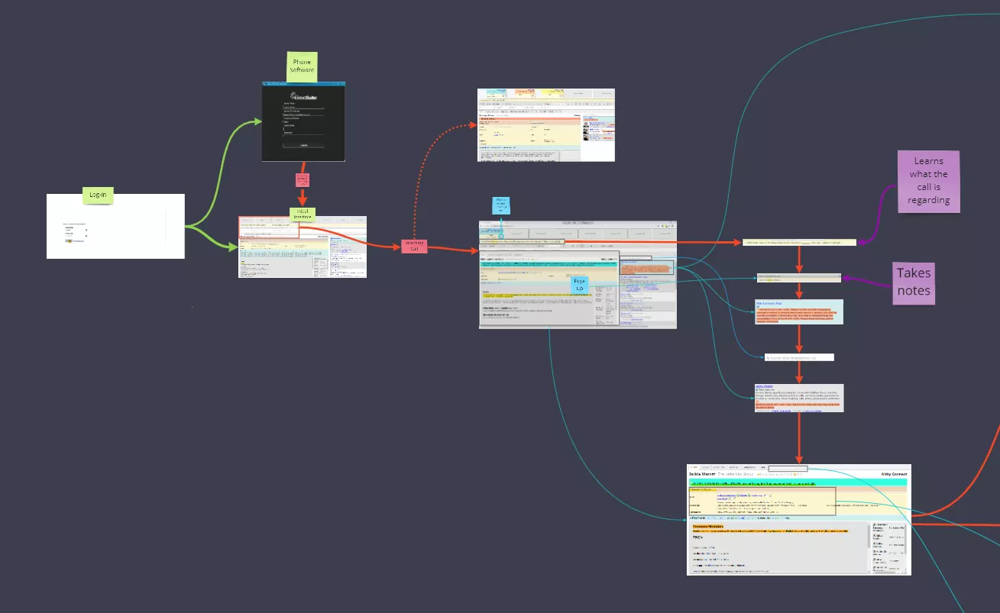
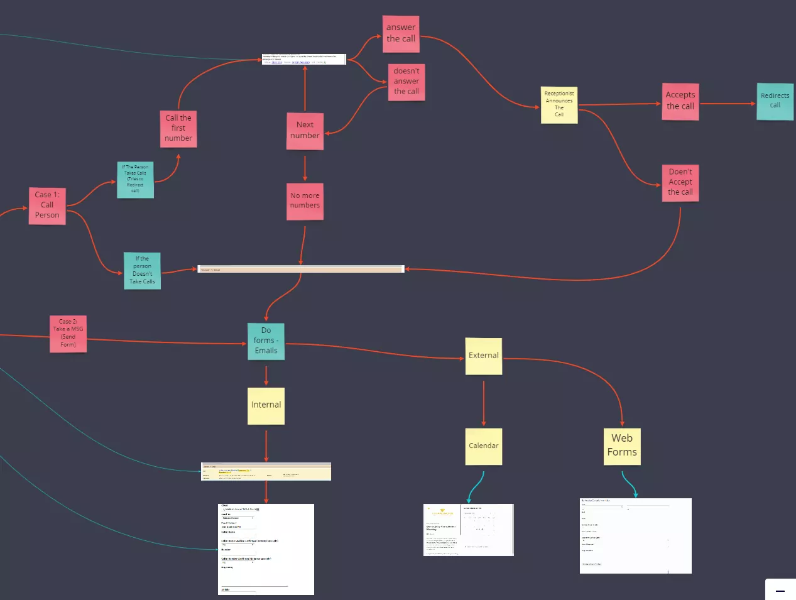
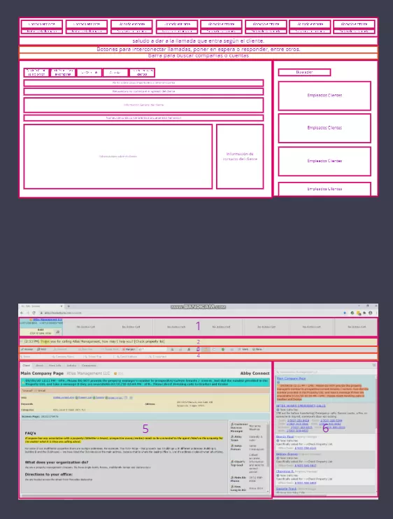
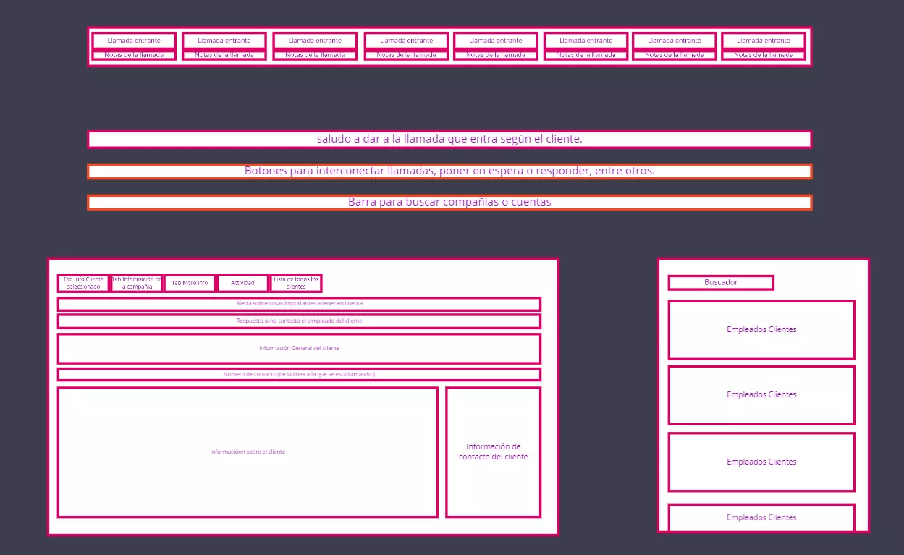
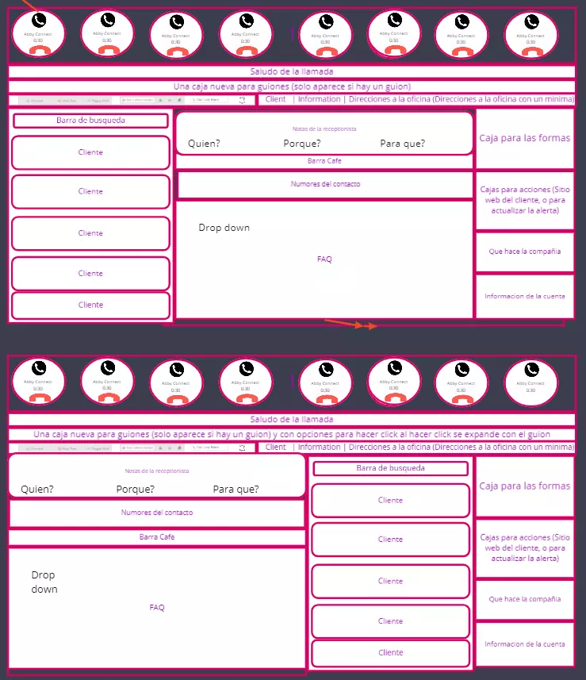
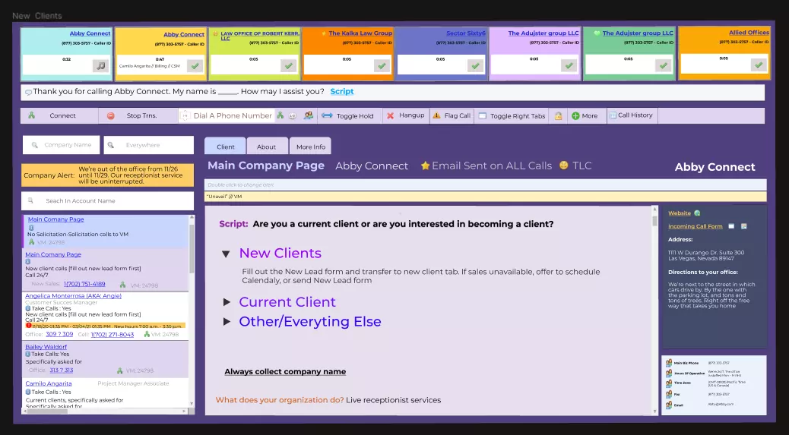
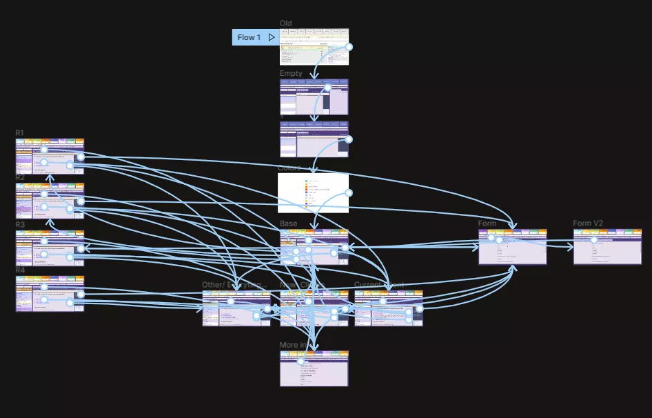
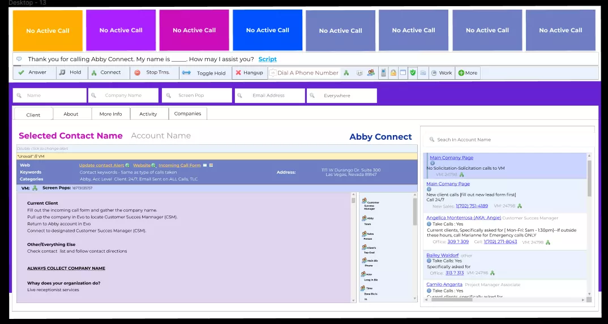

Abby Connect is a United States company located in Las Vegas that provides receptionists for small businesses, Abby was looking to revamp their receptionists' user interface as it was outdated (according to their terms) and unresponsive with the re-branding that was being done. At the same time, they wanted to reduce the visual load of the page, and optimize the flow of action of people.

The project was carried out together with the company manager, through virtual meetings. The difficulty of the project was that many people would be seeing this interface all day throughout their lives for their work, so it had to be comfortable, and, on the other hand, an error in this project could mean the loss of much money for the loss of efficiency of the receptionists, not counting the emotional and psychological state.

To start the project I decided that it was important to first see what the current interface was, why it worked, how it worked, and what didn't work, so we made an interaction map, so we could more easily see unnecessary or repetitive interactions.

We could also see what the receptionists' current flow of action is and thus propose a new one, which, on the one hand, would not break with the familiarity they might have with the previous one, but would facilitate repetitive actions that would require many clicks.

After making the map of interactions, the next thing was to see how these interactions moved and how much each one of them was used, in this way we could prioritize importance and thus propose a simpler flow to commonly needed tasks, to do this, we asked some of the receptionists if they allowed us to record their screens throughout the day, four receptionists helped us in this process.

With the videos we were able to start watching them and mark each of the interactions, and thus see which interaction was happening more and which interaction was lost or used very little (or never), at the same time we were able to see the common workflow between them, and that was causing them an impediment.

With this information we took the current interface and divided it into parts, each one with the name of its function, the purpose of this was to use them as blocks, and thus be able to move them along the interface or take them out of it and see how the workflow have changed.

We created multiple variations, taking into account the information collected at the time of prioritizing, and not only this, because we made use of semiotic laws, to give order and both visual and hierarchical meaning to the interface.

Then to this we take each one of the parts of the interface designed and under the criteria of the new visual identity of the company, and a little semiotic principles of contrast, we create a cleaner space, with a feeling of being fresher and more vital, at the same time that it was very little visually fatiguing.

With these images we generated a high fidelity prototype, this in order to be able to pass it on to the receptionists, and obtain functional feedback from them, for this we faked a call, and they went through the prototype trying to handle it.

At the beginning they got a little lost, because they had been working with the previous one for years, but with the passing of time they got used to it and were able to achieve greater efficiency; however, we were able to notice a number of points where the workflow was slowing down, and they also gave us feedback on the aesthetic aspect, the prototype was redone and corrected to reach its final state.

