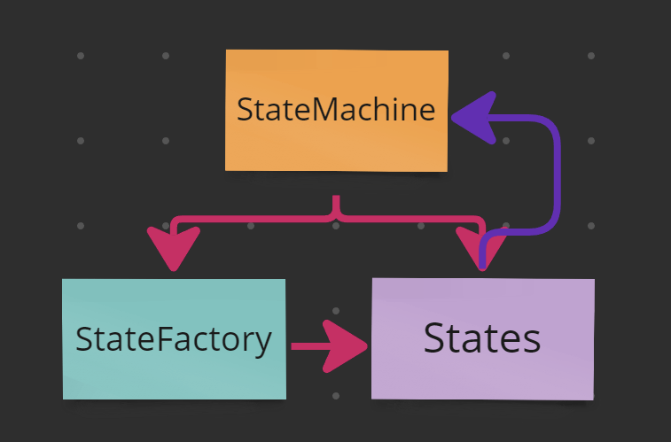

## BITDROID

## Video

<iframe src="https://www.youtube-nocookie.com/embed/00tMO94JzMw" title="Game: BitDroid video" allow="accelerometer; encrypted-media; gyroscope; picture-in-picture; fullscreen" loading="lazy"></iframe>

## Build

### WebGL

[simmer.io/@Ninquiet/bitdroid](https://simmer.io/@Ninquiet/bitdroid)

### Android APK

[drive.google.com/file/d/1uboAKwvmPvxGybUzf7whBWIWJWcflw6M/view](https://drive.google.com/file/d/1uboAKwvmPvxGybUzf7whBWIWJWcflw6M/view?usp=sharing)

## Summary

BitDroid is a platformer. You move with WASD or the arrow keys, jump with the space bar, and open the pause menu with Esc. You aim with the mouse and shoot with the left click, as long as you have ammo, of course.

You can defeat enemies by jumping on top of them, but if they touch you, you die instantly unless you are wearing your helmet. In that case you lose the helmet but can keep fighting. You can also die if a door falls on you or if you land on spikes.

## How it works

### 2D lighting

I used the 2D lighting system to make the game more engaging. As a platformer mixing horror and action, it benefits a lot from being able to highlight points of interest or limit the player's visibility depending on the area. This gives plenty of room to design different kinds of experiences. For example, at the start it is much easier to see which way the player needs to go because the area is well lit, but as you progress the light fades, slowly building a sense of dread toward the unknown.

### Triggers, doors and traps

Triggers are buttons that activate other objects. For now they are only linked to doors, which also work as traps. When the player presses a trigger, it moves the door from one position to another, opening or closing it. There is more than one type of trigger, though: some only raise the door while they are being pressed, and when released the door comes back down. That is where the trap lies, because if the character is crushed by the bottom of the door, they die instantly.

### Ladders

Ladders were a small challenge. While climbing up or down, the character has to disable gravity and allow movement on the Y axis. However, since the character can be attacked while climbing, they could end up flying around aimlessly, so it took many iterations to find the right way to implement them. For the animation, I added a second layer to the Animator whose weight changes depending on whether the character is climbing or not. Everything related to this system lives in **PlayerClimbController**.

### Improved AI

I improved the enemy AI's decision-making, so their attacks are now more precise and they try to better predict the player. They also try to get around obstacles in the level. For example, when part of the level blocks them in the direction they are moving, they try to jump over it to continue the chase.

### Heavy boxes can kill

Heavy boxes can hurt anyone they fall on (only the heavy, non-destructible boxes). This means they can kill any enemy, and they can also kill the player if an enemy pushes one onto them.

### Credits

I created a simple credits screen.

### Improved parallax

The parallax is now wider, covers different heights, and includes dynamic effects such as lightning.

### Multi-layer tilemap

The full level tilemap is now built from 4 different tilemaps, each with its own purpose (for example, one exists only to add new background content and the front part of the level, purely for aesthetics).

### New intro image and splash screen

### New, completely reworked level

The new level is designed around how the player gradually connects with the gameplay. The player clearly learns what a trigger is, because the first one appears in a completely safe starting area. Then they learn they can shoot at range, because the second trigger can only be activated with the ranged weapon. They see an enemy die by falling off a cliff, so they can deduce that falling is dangerous. A second enemy is hard to dodge and will most likely hurt the player, making them lose their helmet. This teaches them that getting hurt costs the helmet, and getting hurt again means death. Since this happens close to the start, it is not a big setback, so they learn without frustration. The same approach applies to other mechanics.

### New sounds

I added new sounds for things like the start of the boss fight and the triggers. To create them I used Udio, an AI sound generation platform, and then edited the results in Adobe Audition.

### New character look

I reworked every character sprite, as well as the power-ups, to give the character more identity. I made the helmet more distinctive (I even used it in the cover illustration) and created new animations, such as the climbing animation.

### Updated weapon rotation

When the player stops shooting, the weapon now rotates to the horizontal direction closest to the last angle it was fired at. It is a small detail, but it makes the character much more pleasant to look at.

### Physics changes

The character now falls faster and jumps lower. This adds some limitations to the character and makes dodging enemy attacks a real challenge.

### Android version and touch controls

To create the Android version, I had to change how input worked (everywhere input was used) and centralized it in PlayerInputs.cs. This class returns the state of each input according to the active system. When it detects a touch, it switches to the touch system, and when it detects a key press, it switches to the keyboard and mouse system.

To build these systems, I first created PlayerInputHandler, the abstract base the other systems are built on. Then I created KeyboardAndMouseInputHandler and remapped every input I had been using before. The real challenge was TouchInputHandler.cs, which has to answer the same requests but from touch input. It treats the left half of the screen as the movement touch area and the right half as the shooting touch area (unless the player is touching the jump button), and a jump button handles the start and end of the jump.

### Charged shot

The character can now charge their shot, and a mask-based system displays the current charge level. The shot's power rises and falls depending on how long the click is held down, so the player can fire short or long shots depending on their strategy, all with a single click.

The projectile changes its rotation according to its velocity and direction, which are also affected by gravity, so the shots follow a noticeably curved path, similar to Worms.

This is achieved by combining ShootingController with BasicBullet (the class that holds the projectile itself). ShootingController handles all the calculations related to shooting (whether the character can shoot or not is controlled by each sub-state in the state machine).

When the projectile collides with something, it checks whether that object is on the Environment layer. If so, it spawns explosion particles and destroys itself. If it hits an enemy instead, it spawns blood particles, looks for the LifeController on the enemy, calls TakeDamage and destroys itself.

This is very important, because it means projectiles can interact with any object that has a LifeController and (in the case of BasicBullet) is on the Enemy layer with the Enemy tag. I also use this to destroy objects in the level, such as boxes.

### State-changing pickups

There are two types of pickups: Health, which increases health, and Munition, which increases ammo.

Health works in the style of Super Mario Bros: it changes the character's appearance, turning them green and adding a little cap. This means we have two hit points, which is the maximum. If we get hit, we lose the cap and the green color, meaning we are back to one hit point.

Munition, on the other hand, is the main way to get ammo in the game. This item increases the weapon's ammo by 5, and the current ammo count is always visible in the top-left corner of the UI.

Every time the character shoots, the weapon plays a small animation where it shrinks (and turns red). It grows back if the character still has ammo. If there is no ammo left, the weapon stays small until the player finds more. This is also controlled by **ShootingController.cs**.

However, to get these items, the player has to break the boxes scattered throughout the level. There are 4 types:

The first is BoxItem, simply a box that breaks. It can be broken by jumping on it or by shooting it, and it is the base for the other boxes.

The second is BoxHealth, which leaves a Health item behind when destroyed.

The third is BoxMunition, which leaves ammo behind when destroyed.

Finally, there is BoxNonDestructible, which, as the name suggests, cannot be destroyed. I created it to build small puzzles where boxes with items are trapped under indestructible boxes, to see how the player figures out how to move the boxes and get the items.

### Checkpoints and save states

To talk about checkpoints, I first need to talk about the save and tracking system. This is handled by SaveSystem.cs, a class I originally created as a MonoBehaviour. As the project progressed, I realized it needed to be more independent from the scenes, and I did not want to create a persistent object, so I decided to make the class entirely static.

It takes care of creating the file and directory and saves the game in JSON format. To save the game in different slots, I created these two serializable data structures:

For now, I only saw the need to save the checkpoint position (since there is only one level), but if I needed more information I would only have to modify SaveData.

The checkpoint itself is much simpler (although it has a nice animation). In short, it is a trigger that, when it collides with the player, tells the SaveSystem to save that position.

### Sounds!

For the sound system, I took some inspiration from the save system, so it is a semi-static system: its instance is static, and through it you can access any of its actions. To organize all the possible sounds, I created an enum listing each of them.

Then I added references to each audio clip and the audio source in the class, and in the PlayAudio method I use a switch to play the sound that matches the selection.

### New enemies

There are now, in theory, three new enemy variants (since the base enemy was also modified).

First is the base enemy. Its range was increased, and it gained a new ability: jumping. It does not just jump at random; it jumps depending on its situation (for example, when it is blocked) and when it detects that the player is above it. This lets it climb, and enemies can even climb by stacking on top of each other. All the details of how it works are in its StateMachine.

Second is the pink enemy. It is faster, and unlike the base enemy, which stops jumping when it is at the same height as the player, it keeps doing small hops anyway. This makes it much harder to shoot and much more dangerous. It is a small change, but it affects the gameplay quite a bit.

Third is the yellow enemy, which is completely different from the others. Although it can also be defeated by jumping on it, it keeps its distance from the player. When shot at, it tries to dodge the projectile, and after a few seconds it quickly lunges at the player before returning to a defensive position.

Finally, there is the **final boss**, which is programmed in a completely different way. All of its code is in FinalBoss.cs. In short, it waits until a nearby trigger signals that the battle should begin. At that moment the boss drops down to a height where it can be shot and starts releasing objects at random. It can drop items such as ammo or health, and it can also release basic or pink enemies (I did not add yellow ones because I thought it would be too hard). When defeated, the boss self-destructs with some particles, the victory sound plays, and the player is picked up again by the helicopter, showing the victory screen.

### Improved UI

I replaced the fonts, texts, buttons and styles, reorganized everything, and improved the look of each screen. I also added the ability to access different saved games.

## The original version

I built it with scalability in mind, so I created a basic state machine that works for all characters (I count both enemies and the player as characters), while each one creates its own implementation. For example, the player's movement is driven by the input system (I used the new Input System for this implementation), while enemies' movement is driven by triggers that detect the player.

The state machine is hierarchical. It first moves between root states such as Grounded, Jump and Airborne. When entered, these states assign second-level sub-states based on the variables in the context (the context is the state machine). These sub-states can also assign their own sub-states, which is why some sub-states in turn assign the HorizontalMovement sub-state.

The rest is quite simple: each character (player and enemies) creates its own variant of the base state machine and its own implementations. The idea was that they would also create their own sub-states and state factory, but in the end that was not necessary (it is still there so the project can scale in the future).

For animation, I created a class called "CharacterAnimationController.cs", which the state machine states control, sending different changes to the Animator. The Animator uses sub-states to handle the actions for when the character is in the air or on the ground (for the enemies, I used a copy of the same Animator with the enemy animations).

For the level, I used a tilemap where I created a dynamic tile that I used for the entire level.

## Assets used

[DoTween](https://assetstore.unity.com/packages/tools/animation/dotween-hotween-v2-27676)
For quick transitions.

Cinemachine
To control the camera movement.

[Kenney 1bit Asset](https://kenney.nl/assets/1-bit-platformer-pack)
I used this texture pack to create all the sprites in the game.
