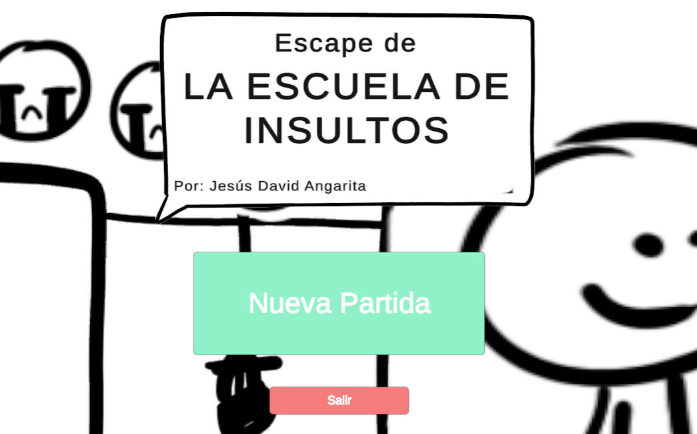
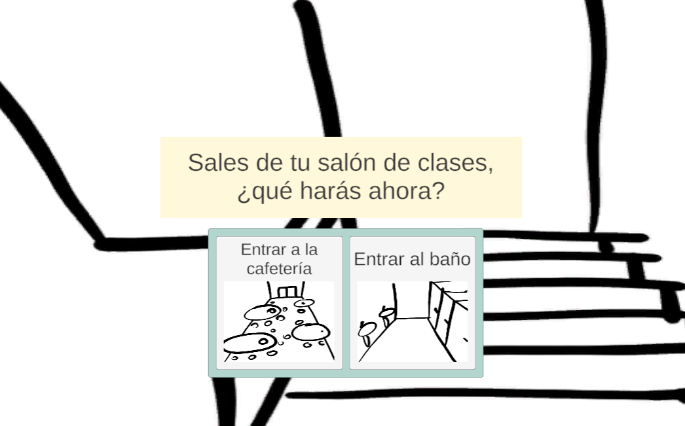
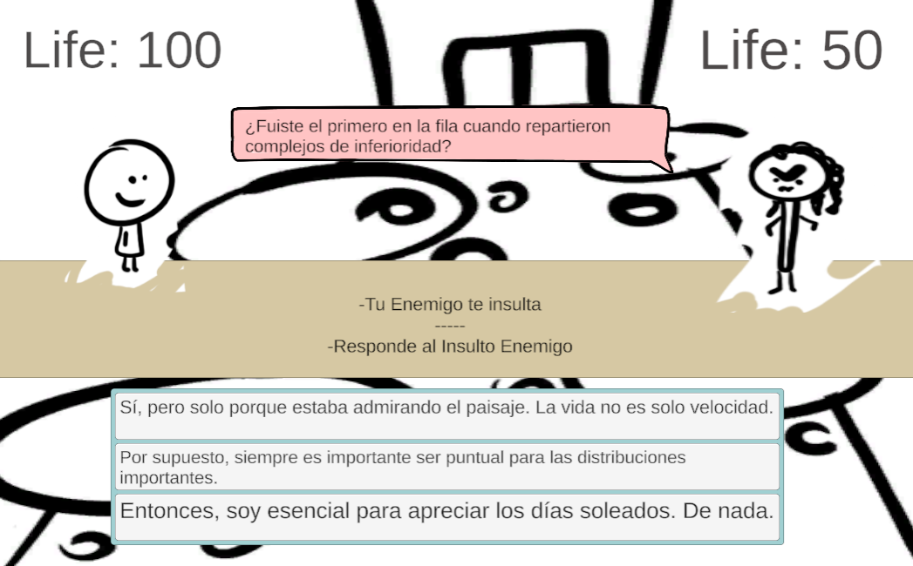
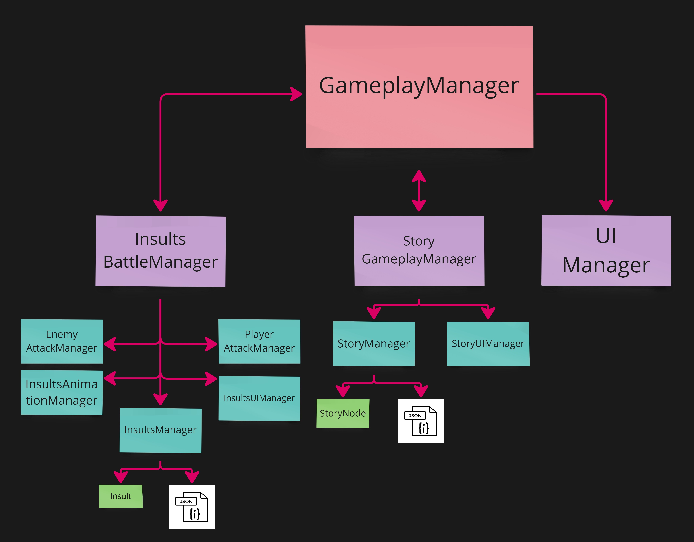
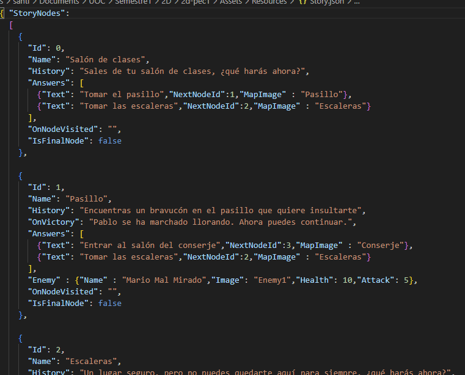
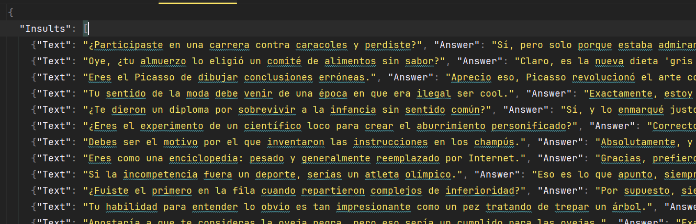
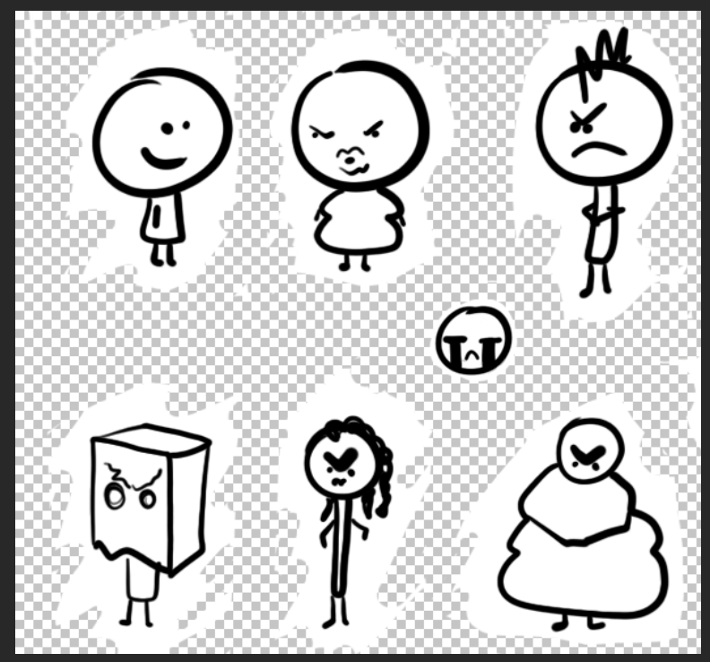

Repository: https://gitlab.com/Ninquiet/ninquietuoc-2d-pec1

## Table of Contents

- [Play in WebGL](#play-in-webgl)

- [Summary](#summary)

[Mechanics](#mechanics)

- [Moving Through the Scenes](#moving-through-the-scenes)

- [Insult Battles](#insult-battles)

[Code Logic and Structure](#code-logic-and-structure)

- [How I Wrote the Code](#how-i-wrote-the-code)

- [External Libraries](#external-libraries)

- [Structure](#structure)

- [Base Core](#base-core)

- [Story Core](#story-core)

- [InsultsBattle Core](#insultsbattle-core)

- [Illustrations](#illustrations)

## Game Video

<iframe src="https://www.youtube-nocookie.com/embed/vO3QHNyNFLE" title="Game: Escapa de la Escuela de Insultos video" allow="accelerometer; encrypted-media; gyroscope; picture-in-picture; fullscreen" loading="lazy"></iframe>

## Play in WebGL

To play, visit this link: [Play "Escapa de la Escuela de Insultos" here](https://simmer.io/@Ninquiet/escapa-de-la-escuela-de-insultos)

## Summary

This game is based on the insult sword fights from Monkey Island: your opponent insults you, you pick a comeback, and depending on your choice you either counter their attack or you don't. Then it's your turn to insult them.

## Mechanics

The game combines exploring the scenes through choices with insult battles, so every scene has something to find or an enemy to defeat before you can move on.

### Moving Through the Scenes

The scenes play a central role in the game. To move between them, just press the button for the scene you want to go to; they are how you progress through the game. In some you'll find items such as a key, while in many others you'll run into enemies that only appear in those places. You have to work your way through the different scenes to reach the door with the key and escape.

### Insult Battles

In insult battles, the enemy opens by picking a random insult, and the player must choose the correct comeback out of three options. If the player chooses correctly, the enemy's attack has no effect; if not, the attack damages the player.

Then it's the player's turn to insult the enemy. The player picks an insult from the options shown (randomly drawn from the insult list), and the enemy has to try to answer it with the correct comeback.

## Code Logic and Structure

### How I Wrote the Code

The code is written following the self-documenting code approach (I try to follow the guidelines from the book Clean Code). I also wrote the code in English (except for anything displayed to the player, such as dialogue or other text), since that is the standard international convention.

I originally built the code around C#'s Task system, but when I finished the game and exported it to WebGL, I discovered that WebGL doesn't handle timed delays well (if at all). So I had to look for alternatives, and I ended up making extensive use of DoTween and UniTask (both free libraries).

### External Libraries

[**DoTween**](https://dotween.demigiant.com)

I mainly used DoTween to handle simple animations. I'm not a big fan of using the Animator for simple things, mostly because of its high performance cost.

[**UniTask**](https://github.com/Cysharp/UniTask)

UniTask is similar to C#'s Task system but optimized for Unity, so thanks to it I was able to fix the delay issues on the web build without rewriting the whole project.

### Structure

I used the adventure game as a starting point, because I wanted the game to be a small adventure rather than just a single battle. However, I modified it heavily (it may now be only a distant relative of the original). This Story mode structure is fed in real time by the **Story** document located inside the **Resources** folder.

### Base Core

This core is made up of the general and control scripts (found in "/Scripts"). Its main component is **GameplayManager**. It's not a long script, but its job is to start the game and act as a bridge between the different events that happen, connecting Story mode with the insult battles and vice versa.

### Story Core

The Story core consists of all the scripts inside **"/Scripts/Story"**. The main handler is **StoryGameplayManager**, which manages the story and its loop. On initialization, it uses **StoryManager** to translate the data from the Story JSON into nodes, then starts the text and options. To display the text it uses **StoryUIManager**, which is responsible for all Story-related UI. To connect everything, I use an Action-based event system.

When the Story module detects an enemy in the player's current scene, it notifies GameplayManager that there is an enemy and what type it is. GameplayManager uses "UIManager" to activate the battle interface and notifies "InsultsBattleManager" to start the battle with that enemy.

Once the battle ends, GameplayManager notifies StoryGameplayManager, which resumes Story mode.

### InsultsBattle Core

This core handles everything related to battles. It is told which enemy the battle will be against, and it takes care of setting up that enemy and controlling the interface with the help of "StoryUIManager". If the player dies, the defeat is reported to GameplayManager, which shows the defeat screen. If the player wins, GameplayManager is also notified, closes battle mode, and resumes Story mode.

The insults are loaded from the **TestingInsults** file in the /Resources folder. **Insults Manager** is responsible for deserializing these files into DTOs and then converting them into the final class formats.

## Illustrations

I made the illustrations myself. They're not the prettiest, but they were made with a lot of love.
