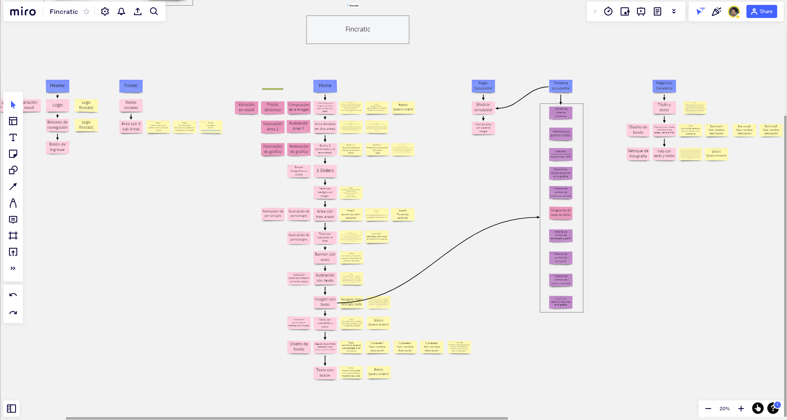
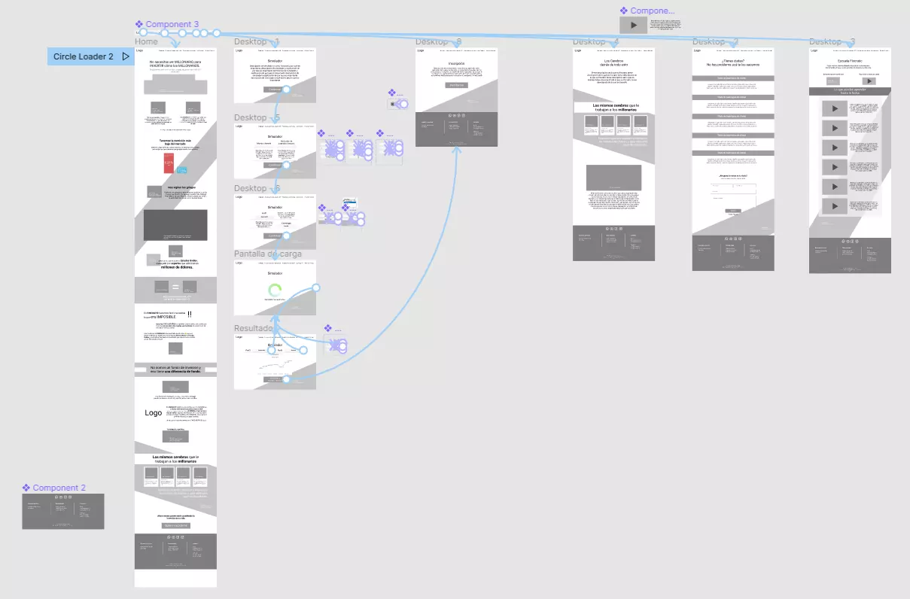
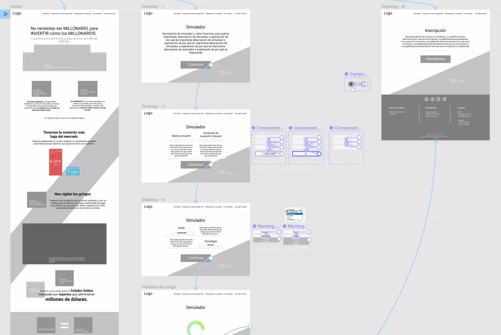
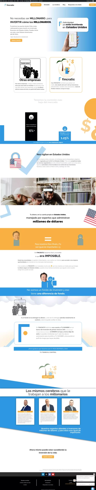
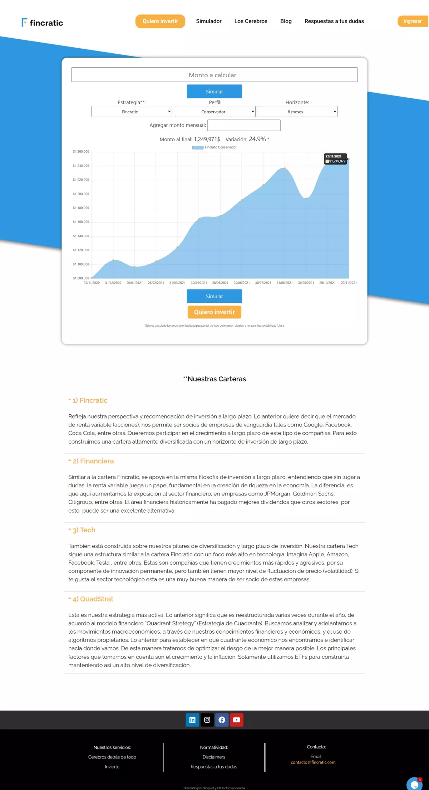
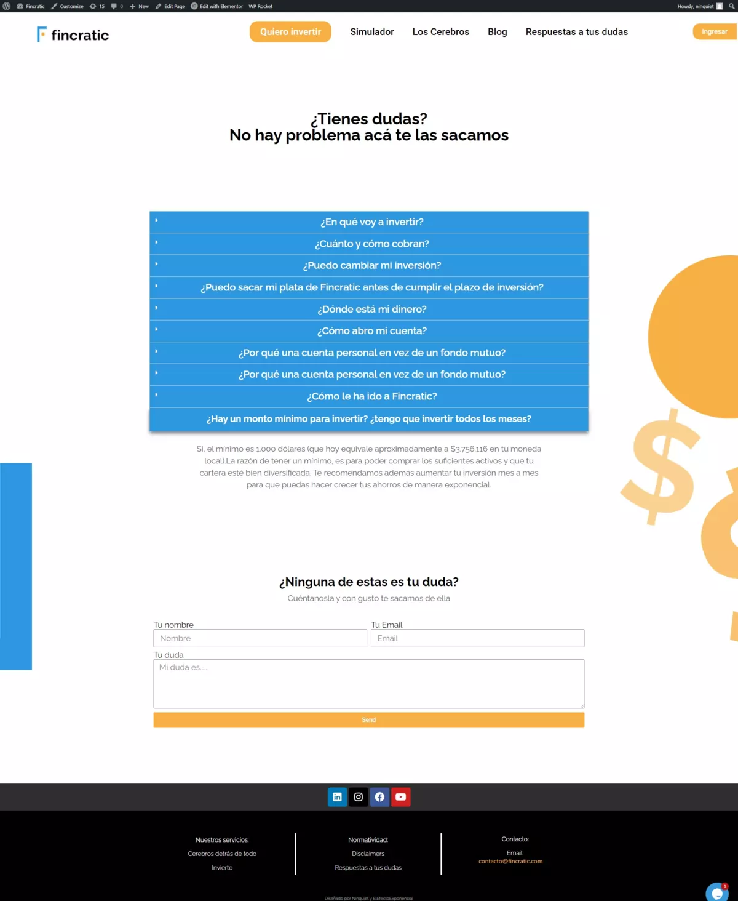

Home

Fincratic is a Chilean company, which sought to have a position on the web, its identity was still in development, but its creators were clear about what they wanted to differentiate them as a product, a more informal and less serious, more democratic attitude.

At the time of starting the project they already had a visual identity and an established goal, the web page would work as a funnel that would guide its users through the registration process.

We talked for a long time trying to organize the ideas they had, for this I used a Miro board and each one had a link to enter and modify the board, the board quickly grew and grew with each of the requirements, this process helped them to better organize their ideas and have a better vision of what the project would be.

I highlight this part of the project because thanks to the fact that we carried out this process, they were able to make visible parts that might not be necessary or were not very congruent with their brand identity.

With the information clear, I began the development of the functional prototype, focusing solely on the order and meaning of the information.

By socializing the functional prototype with the client, we managed to make visible together that there was information that they really did not have, or that was not transcendental for the company, but we also noticed that an area would be necessary where the user could simulate their movements over time, this to respond to several little things, on the one hand, to create security in the client that the company knows its market and context, on the other hand, it would build trust in the user, and reduce the user's fears by virtually making an investment and seeing it be modified over time without the need to risk money.

In this way, the user would have a first approach to the concept of investing, and would feel that it is not so problematic, at the same time that they can be encouraged to invest when seeing that their money can grow.

Once we had a clear idea of what the development would be, and both the client and I agreed on what would be created, start with the development directly on the web, we skipped the realization of a higher fidelity prototype due to problems of time, because they would need the web page as soon as possible, because they had an event where they would show it, however, I started the development of the web in a modular way, making the client part of each moment of the web, and modifying it in an iterative process.

Simulator

Questions

