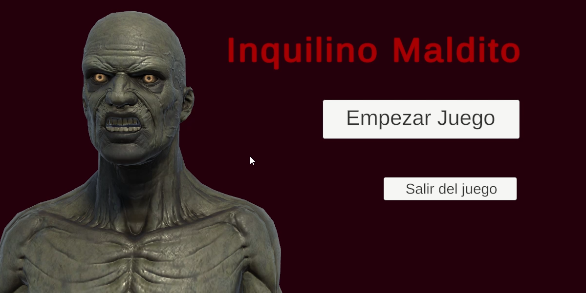
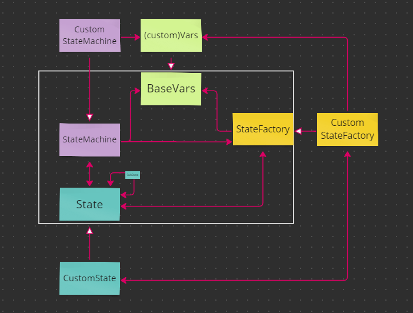
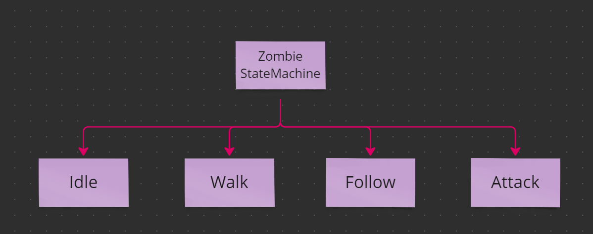
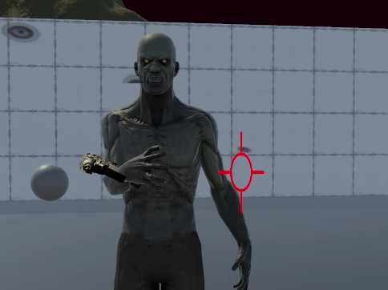
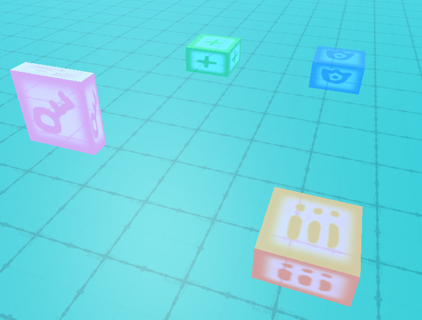
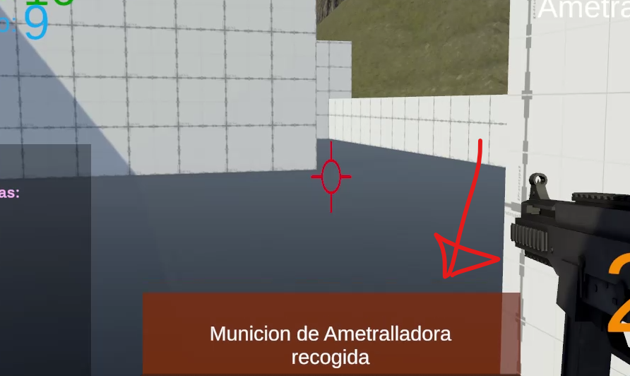
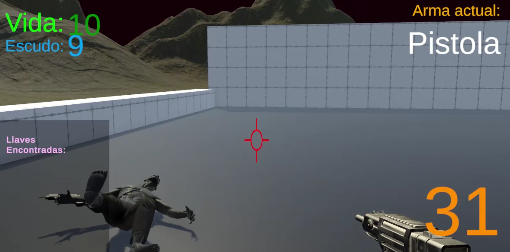

## Video:

<iframe src="https://www.youtube-nocookie.com/embed/5BX8Hnrxqh0" title="Game test: Inquilino Maldito video" allow="accelerometer; encrypted-media; gyroscope; picture-in-picture; fullscreen" loading="lazy"></iframe>

## Build:

Puedes jugar el juego acá:
[https://simmer.io/@Ninquiet/inquilinomalditodemotecnica](https://simmer.io/@Ninquiet/inquilinomalditodemotecnica)

## Resumen:

Es un juego en el que debemos acabar con los zombies y escapar, estos zombies no son solo estaticos sino que tienen un sistema de movimiento bastante logrado

## Funcionamiento:

### State Machine:

Diseñe un sistema de State machine usando generics que me permite re utilizarlo en cualquier parte, incluso en otros proyectos luego de este, este sistema funciona con un StateMachine base que es el nucleo principal de control y la ultima desición, luego tenemos el State Factory que se encarga de organinzar y retornar los diferentes estados existentes, y por ultimo los BaseState (y sus variantes), que se encargan de gestionar los diferentes estados, cómo estar en IDLE luego caminar, luego moverse, y así sucesivamente.

Para hacer este sistema de una forma modular, cree un cuarto integrante que se encarga de gestionar las variables que son de vital importancia para los estados y sub estados, cómo para el state machine tambien, así nace Base Vars.

Teniendo esta estructura, la transicioné para que funcione con estructuras genericas, y de esta forma podria modificarla a mi gusto, con esto pude crear variantes cómo ZombieStateMachine, o más adelante ZombieDistanceStateMachine que hereda de StateMachine y solo modifica algunos estados y algunas variables (y así ese zombie no tuvo que ser escrito desde cero).

(ejemplo de uso de estructura generica)

### Player:

El player no usa state machine, usa PlayerController que hace de base de control de una forma general, las partes importantes del personaje sonn el poder contnrolar su vida (cómo tambien la de los zombies usando LifeController), poder controlar cuantas llaves lleva puestas con KeysHandler, las armas que puede usar con PlayerWeaponHandler, o el poder recoger items con PlayerItemPicker.cs, entre muchos otros sub sistemas que sostienen el jugador.

### Armas y Ataque:

La forma en que funciona el sistema de daño y ataque es que el personaje que ataca revisa si e objeto atacado posee un LifeController, si lo tiene entonces se notifica del daño, el lifeController a su vez usando un sistema de eventos, notifica a todas las clases interesadas de los cambios, e incluso de la posible muerte del jugador.

El Zombie a distancia realiza el ataque desde su sistema de estados, sin embargo el zombie cuerpo a cuerpo hace uso de una tercera clase llamada EnemyBaseAttack, esto para poder tercerizar el proceso de ataque fisico que es un poco más complejo que el realizado por los zombies a distancia.

### La muerte:

Para este efecto y muchos otros que se encuentran en el prototipo hice uso de Cinemachine, al realizar el cambio de camara y jugar con los valores en el UI se logra el efecto de que el jugador cae rendido al morir.

Por su lado, los Zombies manejan la muerte desde uno de sus estados tambien,

Inteligencia del enemigo:
Traté de realizar el state machine de la forma más pulida que pude, así que hay cosas cómo que si el zombie tiene asignados waypoints, zombie seguirá estos waypoints llegado el caso de que pierda de vista al usuario, al momento de regresar al waypoint siempre calcula cual es el más cercano.

Para lograr el movimiento del enemigo usé un sistema de navmesh, interconectado con el StateMachine del zombie y controlado por los estados

Para la animación del zombie disparando usé un poco de blender.

## Effectos

Para una trasnción más limpia y pulida, hice uso de Cinemachine, y no solo esto sino tambien para efectos de camará cómo el shake, para el cual usé el sistema de impulsos.

Para el efecto de disparo usé el sistema de particulas, y algunas texturas basicas creadas en photoshop

## Objeetos

El sistema de objetos permite al jugador interactuar cón objetos de munición, objetos de vida, objetos de escudo, y objetos de llaves, estos ultimos són usados para abrir puertas.

## Notificaciones

Implementé un sistema de Notificaciones a modo de feedback, así el usuario tiene claridad en cuanto a si recogio o no la munición cuanto recibió, si el objeto lo curó o le incrementó el escudo, e incluso para saber la razón por la cual una puerta no se abre, es la forma de interactuar con el usuario.

## UI

Para la interfaz de usuario usé el sistema de acciones ya creado, al subscribir a cada una de las clases (por ejemplo lifeController del player para recibir información de la vida, o PlayerWeaponHandler para recibir información de las armas), se pudo crear un sistema preciso de cada uno de los datos imporntantes a comunicar.

## Sonidos

Para el sistema de sonido cree una base llamada BaseSoundPlayer que se encarga de reproducir en un AudioSource asignado un clip especifico, luego, de esta clase derivé PlayerSounds y ZombieSounds, estas clases guardan en si referencias de sonidos especificas que usaránm de esta forma no repetimos codigo y es bastante util.

## Assets usados:

Para hacer transiciones rapidamente.
