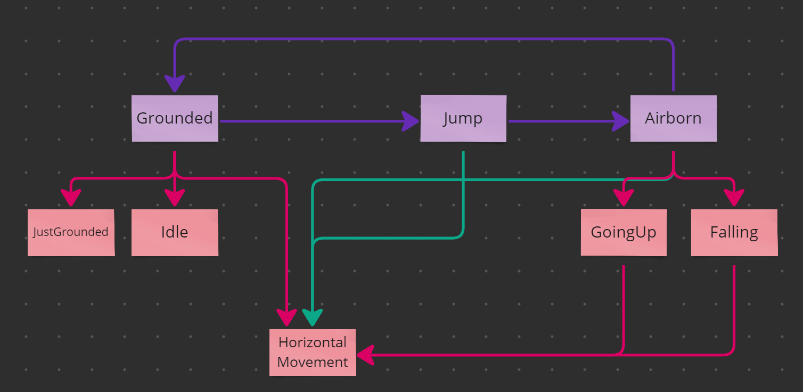
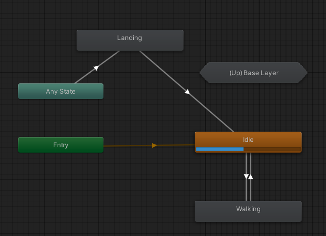

## Video

<iframe src="https://www.youtube-nocookie.com/embed/PQEoYr7PsSE" title="Game Test: INVASION ALIENIGENA video" allow="accelerometer; encrypted-media; gyroscope; picture-in-picture; fullscreen" loading="lazy"></iframe>

## Build

You can play the game here:
[https://simmer.io/@Ninquiet/invasionalienigena](https://simmer.io/@Ninquiet/invasionalienigena)

Android APK:
[https://drive.google.com/file/d/1WEzU8jH1y8nZuNBp5wpDoEjlWRb_Wts-/view?usp=sharing](https://drive.google.com/file/d/1WEzU8jH1y8nZuNBp5wpDoEjlWRb_Wts-/view?usp=sharing)

## Summary

It's a platformer. You move with WASD or the arrow keys, jump with the space bar, open the pause menu with Esc, and aim with the mouse and left-click to shoot (as long as you have ammo, of course).

You can defeat enemies by jumping on top of them, but if they touch you, you die instantly. You can also die by falling into the void.

## How it works

## What's new

### Android version and touch controls

To create the Android version, I had to change how input worked everywhere it was used, and I centralized it in PlayerInputs.cs. This class returns the state of each input according to the active system: when a touch is detected, it activates the touch system, and when a key press is detected, it activates the keyboard and mouse system.

To build these systems, I first created PlayerInputHandler, the abstract base that the other systems are built on. Then I created KeyboardAndMouseInputHandler and remapped every input I had been using before. The real challenge was TouchInputHandler.cs, which has to answer the same requests but from touch input. It treats the left half of the screen as the movement touch area and the right half as the shooting touch area (unless the player is touching the jump button), and a jump button handles the start and end of the jump.

### Charged shot

The character can now charge a shot, and a mask system shows how much charge it has. The power increases and decreases depending on how long the click is held, so the player can fire short or long shots depending on their strategy, all with a single click.

The projectile also changes its rotation according to its velocity and direction, which are in turn affected by gravity, so shots follow a noticeably curved path, similar to Worms.

I achieved this by combining ShootingController with BasicBullet (the class that contains the projectile). ShootingController handles all the calculations for the shot (whether the player can shoot or not is controlled by each substate in the MachineState).

When the projectile collides with something, it checks whether that object is on the Environment layer. If so, it spawns explosion particles and destroys itself. If it hits an enemy instead, it spawns blood particles, finds the enemy's LifeController, calls TakeDamage, and destroys itself.

This is very important, because it means shots can interact with any object that has a LifeController and (in the case of BasicBullet) is on the Enemy layer with the Enemy tag. I also use this to destroy objects in the level, such as boxes.

### Items that change the player's state

There are two kinds of collectible items: Health, which increases health, and Munition, which increases ammo.

Health actually works in a Mario Bros. style: it changes the character, turning them green and adding a little hat. This shows that you have two hit points, which is the maximum. If you get hit, you lose the hat and the green color, meaning you are back to one hit point.

Munition, on the other hand, is the main way to get ammo in the game. This item increases the weapon's ammo by 5, and your current ammo is always visible in the top-left corner of the UI.

Every time you shoot, the character plays a small animation where the weapon shrinks (while it turns red). It grows back if the character still has ammo; if there is no ammo left, the weapon stays small until you find more. This is also controlled by **ShootingController.cs**.

However, to reach these items, you have to break the boxes found throughout the level. There are four types:

The first is BoxItem, a box that simply breaks. It can be broken by jumping on it or by shooting it, and it is the base for the other boxes.

The second is BoxHealth, which leaves a Health item behind when it is destroyed.

The third is BoxMunition, which leaves ammo behind when it is destroyed.

Finally, there is BoxNonDestructible, which, as the name suggests, cannot be destroyed. I created it to build small puzzles where boxes with items sit under indestructible boxes, to see how the player figures out how to move the boxes and get the items.

### Checkpoints and save states

To talk about checkpoints, I first have to talk about the save and record-keeping system. This is handled by SaveSystem.cs, a class I originally created as a MonoBehaviour. As the project progressed, I realized I needed it to be more independent of the scenes, and I didn't want to create a persistent object, so I decided to make the class entirely static.

It creates the save file and directory and stores the game in JSON format. To save games in different slots, I created these two serialized data structures:

For now, I only saw the need to save the checkpoint position (since there is only one level), but if I needed more information, I would only have to modify SaveData.

The checkpoint, on the other hand, is much simpler (although it has a nice animation). In short, it is a trigger that, when it collides with the player, tells the SaveSystem to save that position.

### Sounds!

For the sound system, I took some inspiration from the save system, so it is semi-static: the instance is static, and any of its actions can be accessed through it. To organize all the possible sounds, I created an enum listing each one.

Then I added references to each audio clip and to the audio source in the class, and in the PlayAudio method I use a switch to play the selected sound.

### New enemies

There are now, in theory, three new enemy variants (since the base enemy was also modified).

First, the base enemy: its range was increased and it gained a new ability, jumping. It doesn't just jump randomly; it jumps depending on its situation (for example, if it is blocked) and when it detects that the player is above it. This lets it climb, and enemies can even climb by stacking on top of each other. All the details of how it works are in its state machine.

Second, the pink enemy is faster. Unlike the base enemy, which stops jumping when it is at the same height as the player, this one keeps making small jumps, which makes it much harder to shoot and much more dangerous. It is a small change, but it has a big impact on gameplay.

Third, the yellow enemy is completely different from the others. Although it can also be defeated by jumping on it, it keeps a certain distance from the player. When shot at, it tries to dodge, and after a few seconds it quickly lunges at the player and then returns to a defensive position.

Finally, there is the **final boss**, which is programmed in a completely different way. All of its code is in FinalBoss.cs. In short, it waits until a nearby trigger signals that the battle should start. At that point, the boss moves down to a level where it can be shot and starts releasing random objects: items such as ammo or health, as well as basic or pink enemies (I didn't include yellow ones because I thought it would be too hard). When defeated, the boss self-destructs with some particles, the victory sound plays, and the helicopter picks up the player again, showing the victory screen.

### Improved UI

I replaced the fonts, texts, buttons, and styles, reorganized everything, and improved the look of each screen. I also added the ability to access different saved games.

## Original version

I built it with scalability in mind, so I created a basic state machine that works for all characters (I count both the enemies and the player as characters), while each one creates its own implementation. For example, the player's movement is driven by the input system (I used the new Input System for this implementation), while the enemies' movement is driven by triggers that detect the player.

The state machine is hierarchical. It first moves between root states such as Grounded, Jump, and Airborne. When entered, these states assign second-level substates based on the variables in the context (the context is the state machine). These substates can also assign their own substates, which is why some of them assign the HorizontalMovement substate.

The rest is very simple: each character (player and enemies) creates its own variant of the base state machine with its own implementation. The idea was for them to also create their own substates and state factory, but in the end that wasn't necessary (it is still there so the project can scale in the future).

For animation, I created a class called "CharacterAnimationController.cs", which the state machine's states control by sending different changes to the animator. The animator uses substates to handle actions when the character is in the air or on the ground (for the enemies, I used a copy of the same animator with the enemy animations).

For the level, I used a tilemap where I created a dynamic tile that I used for the entire level.

## Assets used

[DoTween](https://assetstore.unity.com/packages/tools/animation/dotween-hotween-v2-27676)
For quick transitions.

Cinemachine
For controlling camera movement.

[Kenney 1bit Asset](https://kenney.nl/assets/1-bit-platformer-pack)
I used this texture to create all the sprites.
