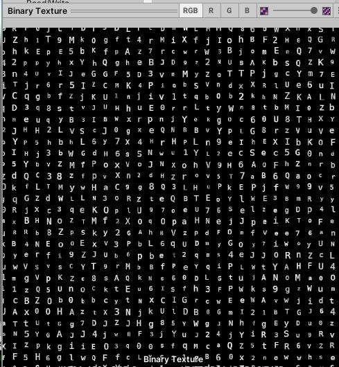
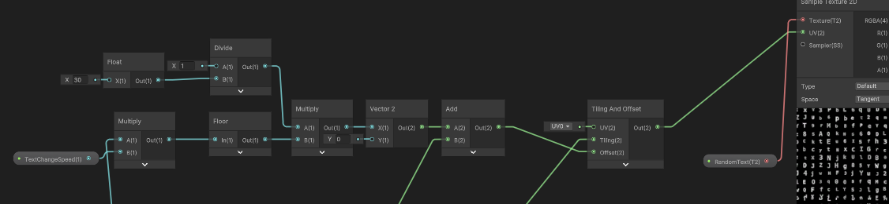
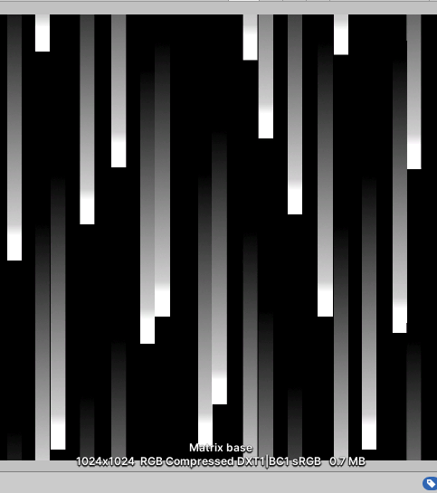
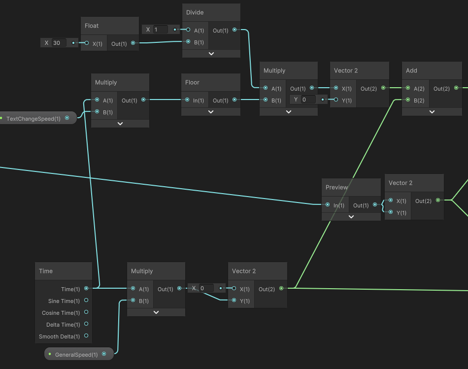
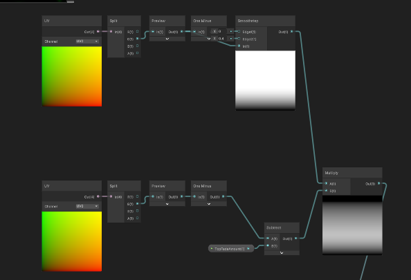
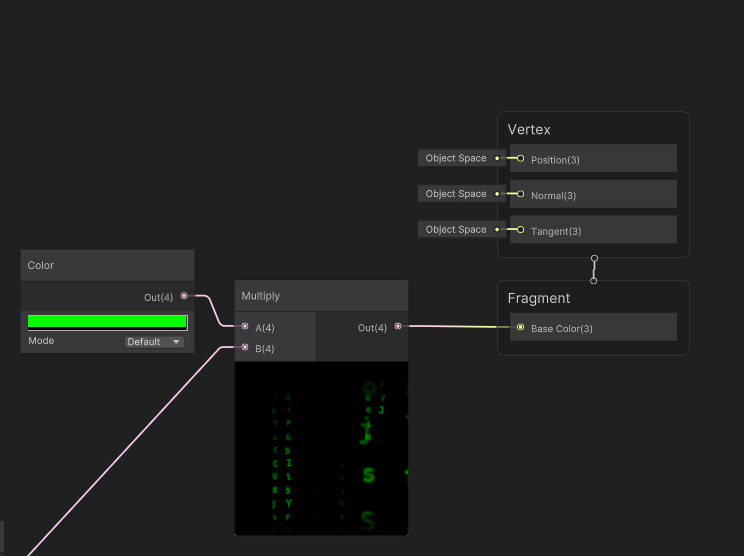
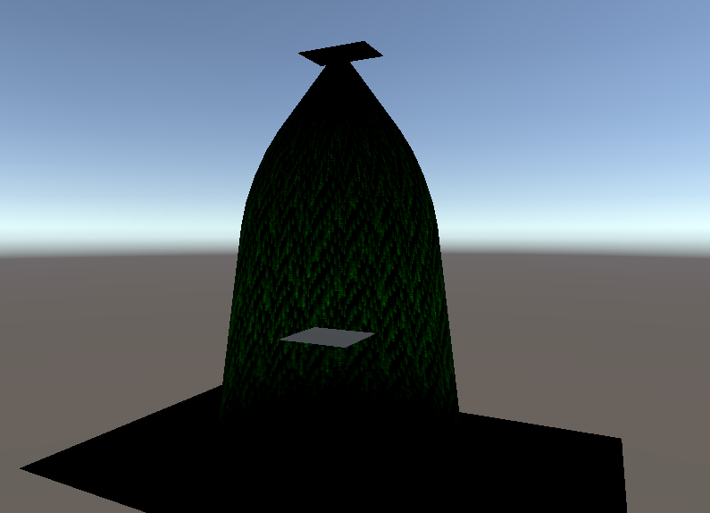

A Matrix-style "code rain" effect built in a single shader.

## Problem

The goal was the feeling of training inside the Matrix: endless columns of changing characters falling around you, without simulating thousands of individual characters.

## Approach

For the random changing characters, I created a texture of random symbols laid out on a grid with even spacing.

Then, by adding a constant offset on Y and nudging X by fixed steps (a floor node keeps the values snapped), I got characters that change over time:

Next, I made a simple texture of falling lines with an especially bright tip, and tiled it into an infinite pattern.

Reusing some of the logic from before, I added movement:

Multiplying both effects gives the base. From there I added extra passes, combined them, and faded the top and bottom of the shape smoothly.

Finally, everything is multiplied by a color before output.

The last step is a mesh with inverted faces that fits the infinite-top look without visual breaks from culling.

<iframe src="https://www.youtube-nocookie.com/embed/ro8pqshcnUw" title="VFX - Matrix Code Rain video" allow="accelerometer; encrypted-media; gyroscope; picture-in-picture; fullscreen" loading="lazy"></iframe>

## Performance

Everything happens in one shader on a single mesh, with no particles or per-character objects, which keeps the effect cheap enough to surround the player.
