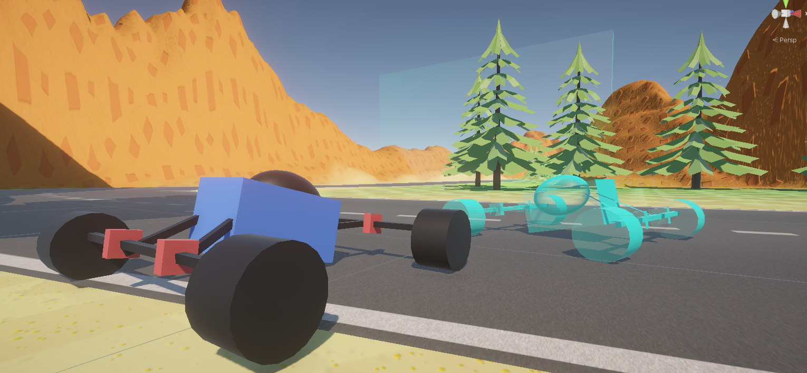
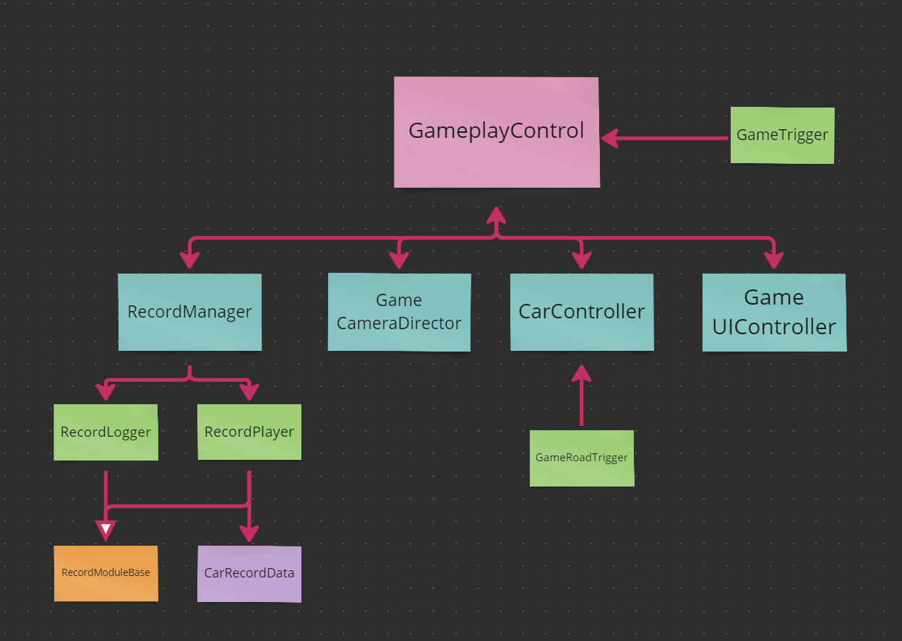

## Video

<iframe src="https://www.youtube-nocookie.com/embed/yhKHteLQ37M" title="Game: Race Against the time video" allow="accelerometer; encrypted-media; gyroscope; picture-in-picture; fullscreen" loading="lazy"></iframe>

## Build

You can play the game here:
[https://simmer.io/@Ninquiet/carrera-contra-reloj-v1-pec1](https://simmer.io/@Ninquiet/carrera-contra-reloj-v1-pec1)

## Summary

It's a racing game where you can race against yourself. The controls are simple: WASD to move and the space bar to brake.

**I created all the assets myself: I made the textures in Photoshop and built the character from primitives.**

I also created my own system for recording and replaying runs (it's a custom version).

## How it works

### Game

The main component is GameplayControl, which organizes the start, transition, and end of the match. Then there is GameUIController, which handles everything related to the UI, and finally GameTrigger, the component used to track whether the player passes through certain parts of the track.

### CarControl

Made up of CarController.cs, which handles the car's movement (I customized it a bit).

### CarRecord

Made up of CarRecordData (a serializable class where the data is stored), CarRecordManager (which decides when to record and when to play back), RecordLogger (which records the snapshots), RecordPlayer (which plays back the snapshots), and RecordModuleBase, the abstract base class for RecordLogger and RecordPlayer.

### CameraDirector

Made up only of GameCameraDirector.cs, which controls which camera is used. It is connected to an event in GameplayControl, so when the game ends, it gets notified and starts switching between different cameras. I used Cinemachine for this to get a more polished result.

## Assets used

[Free Trees](https://assetstore.unity.com/packages/3d/vegetation/trees/free-trees-103208)
To add trees (since I'm using URP).

[DoTween](https://assetstore.unity.com/packages/tools/animation/dotween-hotween-v2-27676)
For quick transitions.
