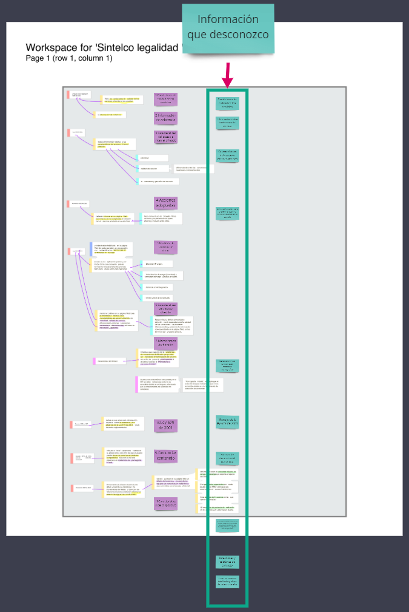
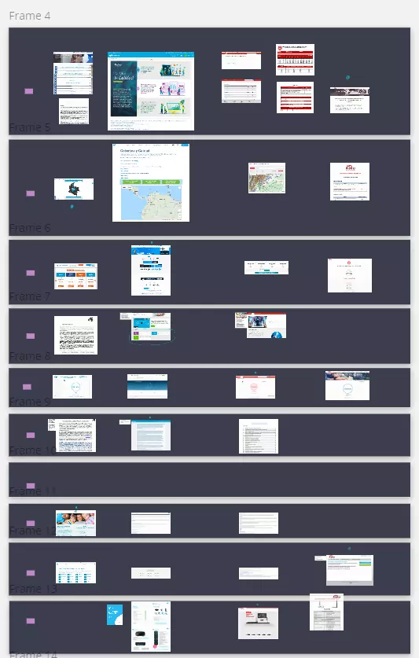
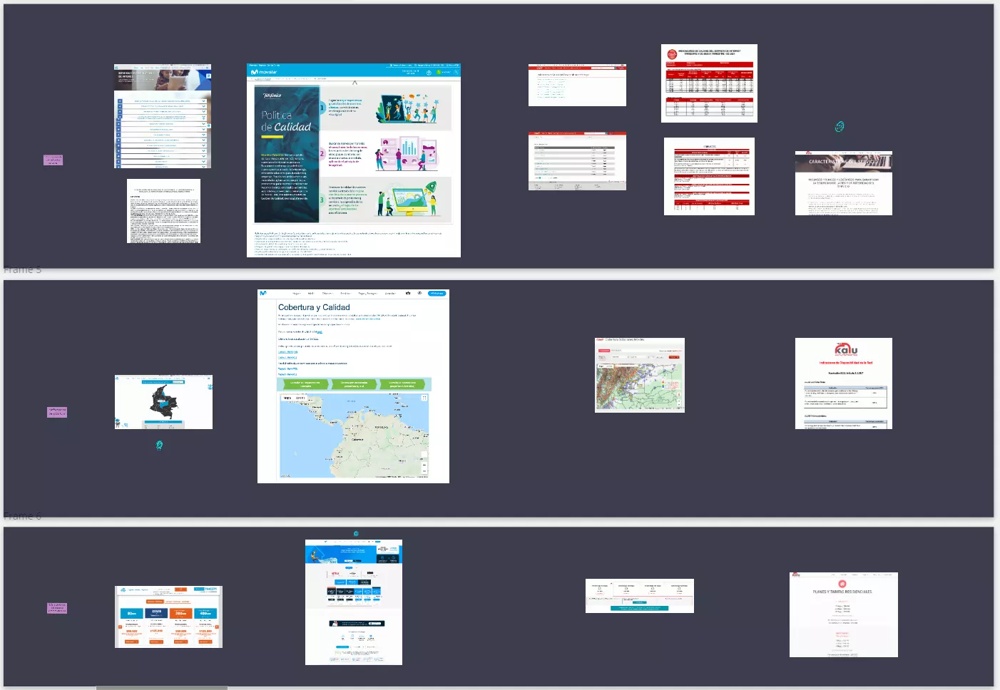
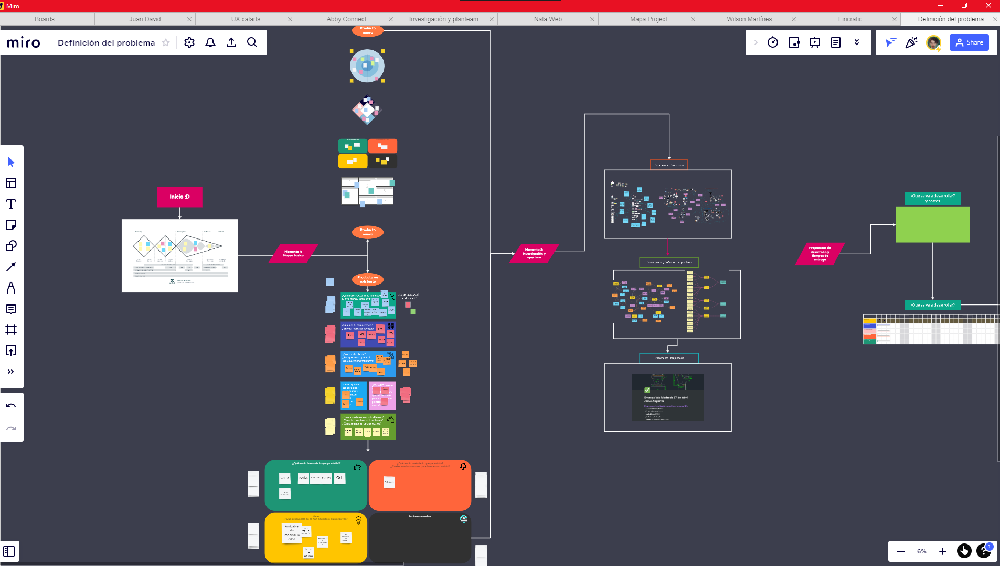
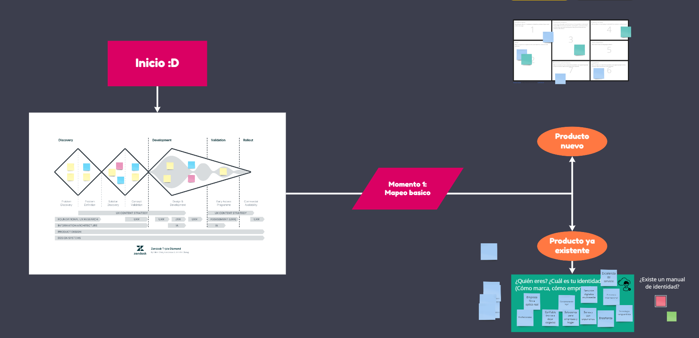
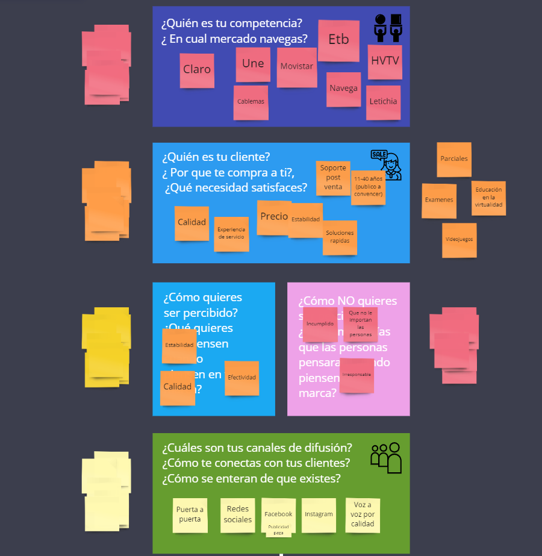
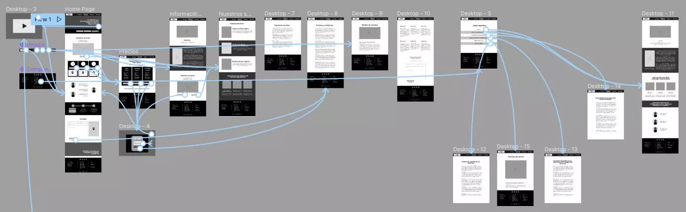
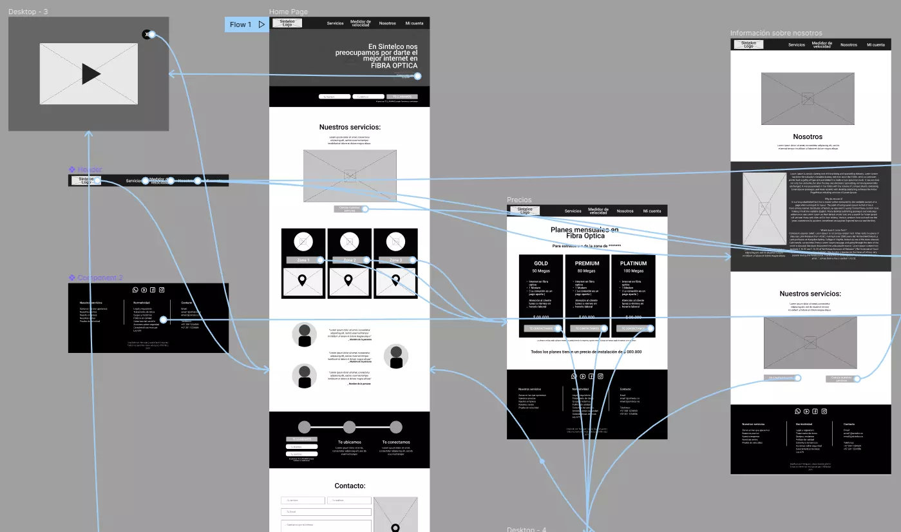
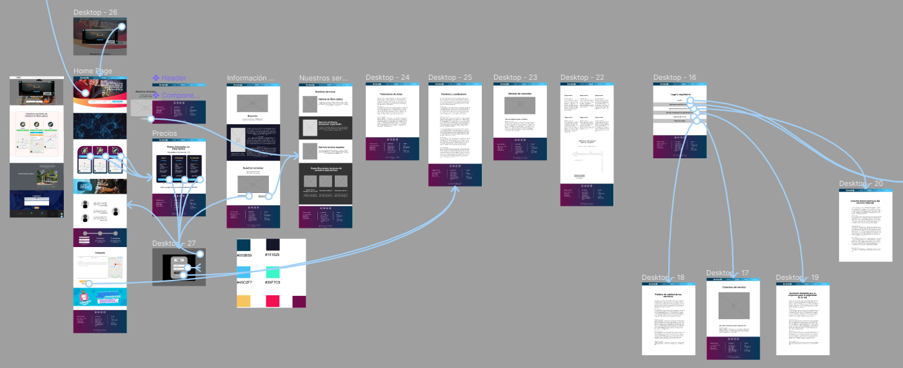
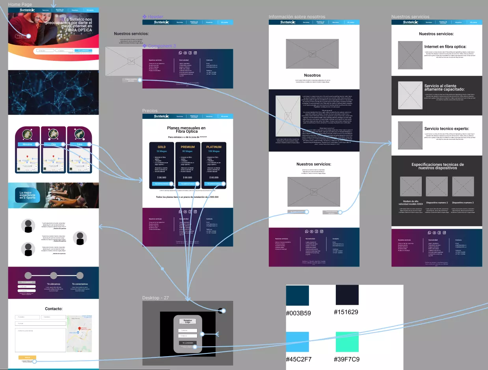

Sintelco is a communications company that focuses its efforts on two areas, fiber optics and the Sintelco Academy, which teaches small companies how to work with fiber optics and the entire technical process that this entails.

The project was a challenge, mainly because there were certain special legal requirements that they had to have, being such a large company, so when they started the project they gave me a document with the clauses that they had to comply with.

I took the document and divided it into parts, and these parts I translated into specific requirements for the web, as well as other parts I separated to socialize them with the company, since I did not know how they manifested themselves in the development of the web.

How the process with this company could not be so dialectical, because it was a very busy company, I took the requirements that had been evidenced, and I made a benchmark process with other communications companies, this to show how these companies responded to these requirements, I selected 9 reference pages, and I organized each of the requirements with screenshots of the areas in which the pages in one way or another responded to this, it was a very rigorous investigation.

As a result, I was able to find that many of the web pages did not respond correctly to the legal requirements, or many, on the other hand, simply responded to very few; however, it was enough information to know the north that the website should take.

With all this information I was able to hold a meeting with the company, I knew that this meeting would be very important for the process, and it would be difficult to achieve another meeting soon, so I designed a strategy to be able to address various points of the project, and to be able to define the problem, to carry out the strategy I used a board in MIRO

I designed the strategy in such a way that in a simple way and through ramifications we could reach a result in a short time and without having to put the weight of development in future meetings.

Part of this strategy was inspired by the Business Model Canvas, the idea with this was to simulate a co-creation workshop virtually and quickly, and to my surprise this process was quite satisfactory for the client, and slowly the questions were causing them to raise their project and outline more clearly what they were looking for.

Taking the requirements into account, I developed a merely functional low-fidelity prototype of the areas that I believed the web page should have, with its proper content, I made this prototype directly, for which I had already made the identity manual of the same company, so he knew maybe how we could be communicating how he marks the requirements.

