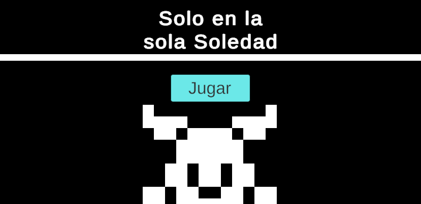
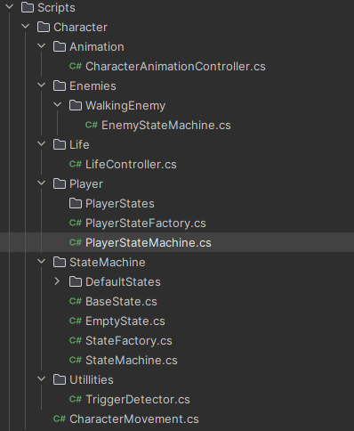
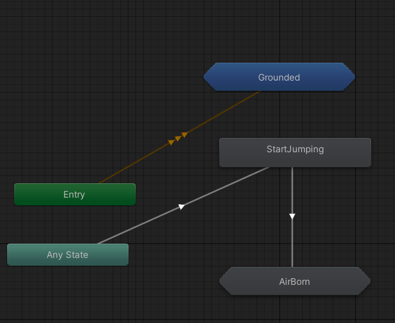

Repositorio:

[gitlab.com/Ninquiet/NinquietUOC-3D-PEC2](https://gitlab.com/Ninquiet/NinquietUOC-3D-PEC2)

## Video:

<iframe src="https://www.youtube-nocookie.com/embed/nOsg76Uqamw" title="Game: SOLO EN LA SOLA SOLEDAD video" allow="accelerometer; encrypted-media; gyroscope; picture-in-picture; fullscreen" loading="lazy"></iframe>

## Build:

Puedes jugar el juego acá:
[https://simmer.io/@Ninquiet/solo-en-la-sola-soledad-beta](https://simmer.io/@Ninquiet/solo-en-la-sola-soledad-beta)

## Resumen:

Es un juego de plataformas, para moverte puedes usar WASD o las flechitas, para saltar usa la barra espaciadora, para entrar a menú pausa puedes usar la tecla Esc

puedes acabar con enemigos saltandoles encima, pero si estos te tocan morirás instantaneamente (está cread para en un futuro agregar un sistema de salud más complejo :3)

## Funcionamiento:

Lo he creado teniendo en cuenta que pueda ser escalable, entnces cree un state machine basico que funcionará para todos los personajes (cuento como persnajes a enemigos y al jugador), pero cada uno creará su propia implementación, por ejemplo el jugador dicta el movimiento según el sistema de input (he usado el nuevo sistema de Input para esta implementacion), mientras que los enemigos dictan su movimiento por triggers que reconocen el jugador

El State machine es gerarquico, así que primero pasa entre estados Root, como: grounded, Jump, y Airborn, y estos estados al entrar asignan sub estados de segunda categoría segun las variables que hay en el contexto (el contecto es el state machine), estos sub estados pueden sub asignarse tambien su estados, por eso algunso sub estados a su vez se asignan el sub estado HorizontalMovment

El resto del funcionamiento es muy simple, solo cada uno (jugador y enemigos) crean sus variantes del state machine base, y crean sus propias implementaciones, la idea era que tambien crearan sus propios sub estados y state factory, pero al final no fue necesario implementarlo (pero sigue estando ahi para poder escalar el proyecto en un futuro)

Para la animación cree una clase llamada "CharacterAnimationController.cs" la cual los estads del state machine tienen cntrol, y envian diferentes cambios para el animator, el animator usados sub estados, para controlar las acciones de cuando el personaje está en el aire o en el suelo, (para el enemigos usé una copia de este mismo animator pero con animaciones del enemigo)

Para el escenario he usado un tilemap donode cree un tile dinamico que he usado para todo el escenario.

## Assets usados:

[DoTween](https://assetstore.unity.com/packages/tools/animation/dotween-hotween-v2-27676)
Para hacer transiciones rapidamente.

Cinemachine
Para hacer controlar el movimiento de la camara.

[Kenney 1bit Asset](https://kenney.nl/assets/1-bit-platformer-pack)
He usado esta textura para crear todos los sprites usados.
