My process always starts with a dialogue with my user, he tells me a little about his idea and I try to delve into this to get to the core of the project, which in most cases the client does not notice at first.

In this case, the client started with a basic idea of what he was looking for, a web page as a business card, but as we progressed in the dialogue, we discovered that he would also need a space to host his courses, which in his strategy It would be good to implement customer reviews, and as we delved into his macro strategy, we realized that the true purpose of this website was to build trust in his customers and position Wilson as someone of high value.

We started thinking about the client, who he is, what interests him, what motivates him, why he does what he does, to carry out this process I conducted a semi-structured interview with Wilson, and with certain general open questions I opened the dialogue between the two, the questions had the function of an excuse and a catalyst, the real potential was in how the dialogue was developing.

Throughout the conversation we were able to build on Wilson's previous clients and projects to begin to profile this client, Wilson began to notice that he knew his clients more than he realized and could better focus his efforts, to guide the conversation and concepts that were emerging I used a virtual board of MIRO, which when shared in the video call, we could see how the conversation was weaving, and what relevant concepts were emerging.

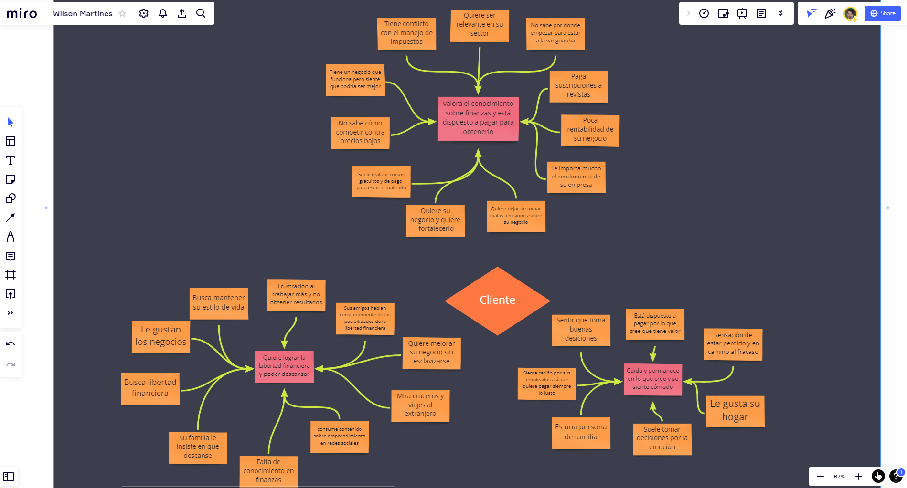

Following this, we began to think a little about what concepts defined Wilson as a brand. This was a very interesting exercise because Wilson, up to that moment, assumed that he knew his brand, but when trying to materialize these concepts, they were not very clear and he was able to notice it, and it was partly difficult, because wilson is dedicated to something that is not very tangible and more abstract, so we tried to create a map of words that would guide us to the concepts that Wilson associates with, so we could try to grasp this concept abstract.

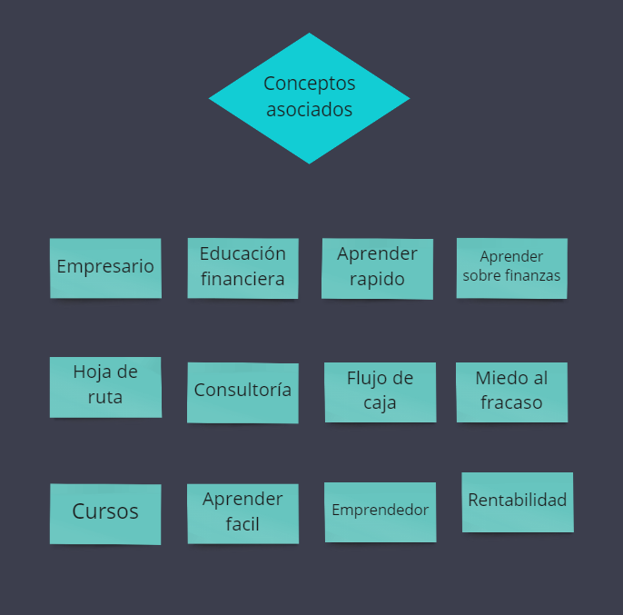

After this we began to see what that added value was, that differentiating value of him over the competition, this value is important to recognize, because after performing a benchmark of the competition we could know how to enhance our strengths and create a great impact.

Initially, we went for the easiest values to measure, things like experience or his specialized knowledge, and then we went to values that were a little more abstract, like his attitude towards clients, or the way he approached teaching him. . Taking these added values, we group them into two, an instructor with extensive experience, who provides his knowledge to non-experts in a simple way.

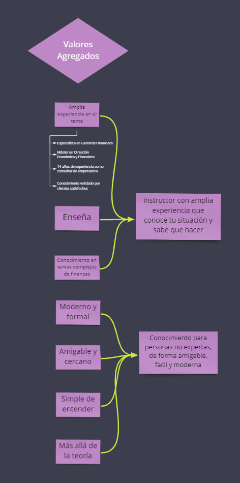

After thinking about this added value, we went on to think about what was the product that he was selling, and how this product was connected with its added value in a congruent way, he had many services in mind, and when analyzing one by one in the light of the added value, we could notice that three of them really made sense, and five of them we could unify into a new one.

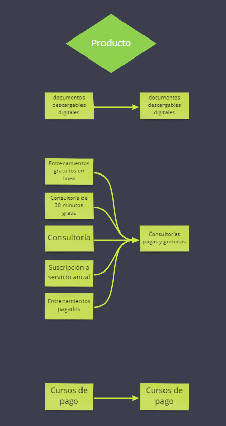

Bearing all these previous values in mind, we were able to start building the message, thinking about it from the client's position, and how with our added value we can offer a solution to their problem, many concepts arose, and these concepts are again grouped into two: "you are not bad, your problem is something common", and" with our help you will dominate your problem, and you will be above the competition"

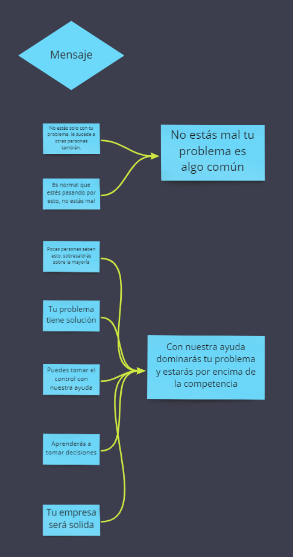

With all this information, we create a small summary of all the information

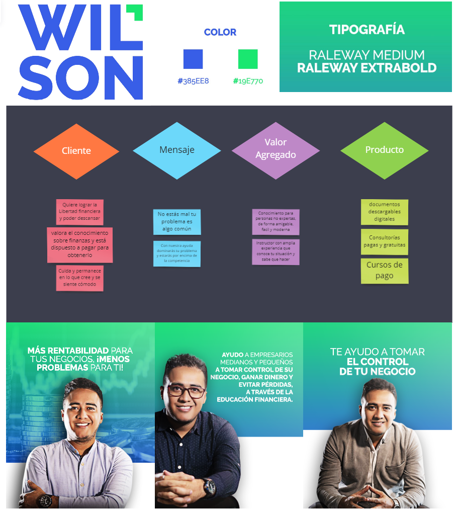

After approving the small summary, we were able to start making a simple content map, where, starting from the concept of a simple Web (Home, about us, contact), we were able to think about the need for these areas, and when thinking about this we were able to notice if there were a necessary area, and what don't fit in there, so we added new areas and be able to make visible how they were interconnected.

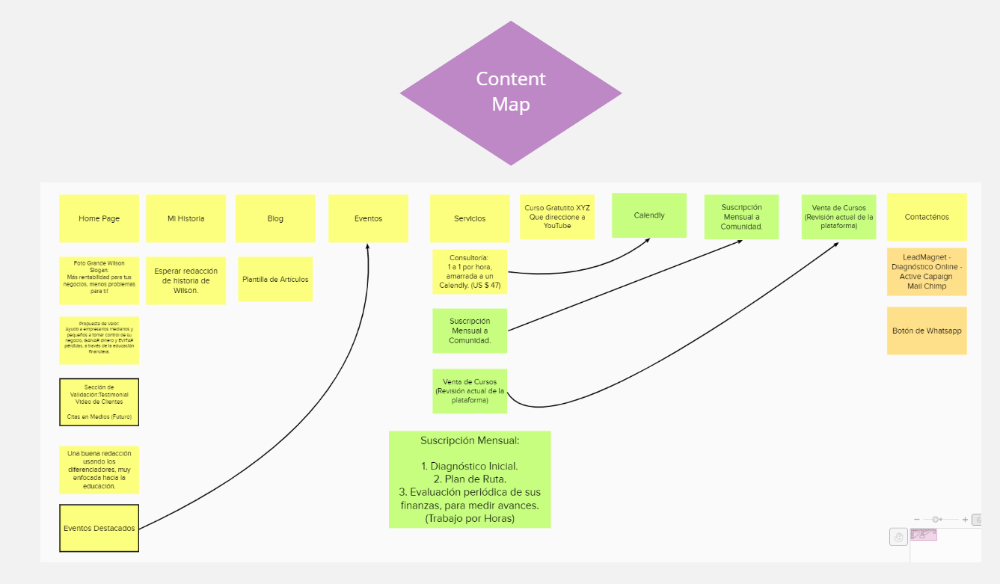

With a visual and shape route, I can start to do a first functional prototype

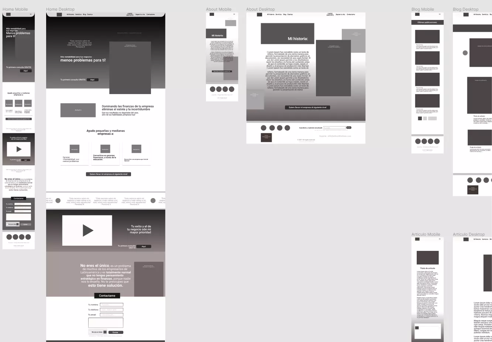

We tweaked the plan, thought a bit about why Wilson was searchable on the web, talked a bit about clients he'd had in the past, and noticed that clients were coming to Wilson primarily for his advice, so we decided to create a dynamic questionnaire.

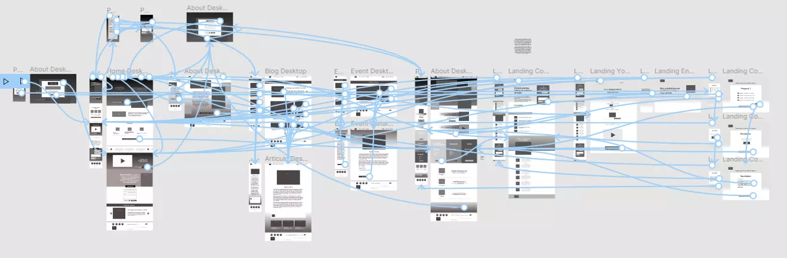

For the creation of this dynamic questionnaire it was necessary for Wilson to think about common questions that his clients asked him and possible answers to these questions, he organized this information in Excel, then with Jscrip I generated a system of layers, and organized each one of these questions in each of these layers, and in the answer area each of the buttons was dynamically generating a personalized text, at the end of the questionnaire the client adds his email and at that moment a PDF is created, with all the information collected, which is sent to your email address, in this way we dynamically collected information from potential future customers.

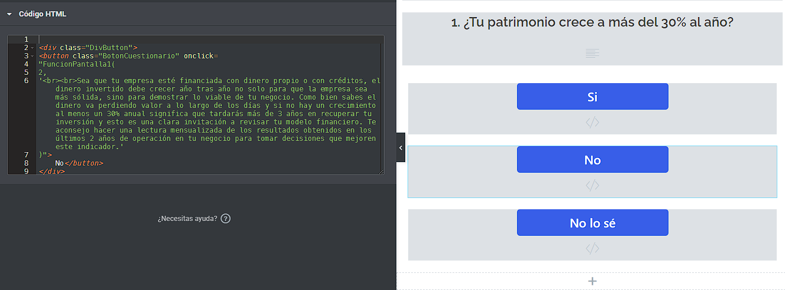

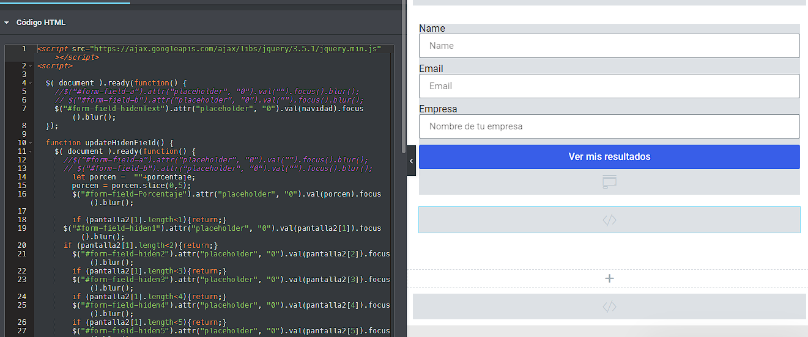

Then finally I was able to create the web page, I used the CMS Wordpress, and Elementor for the Front end, and I took as a visual reference the Visual Guidelines that Wilson has, and others brands that come up in the benchmark.

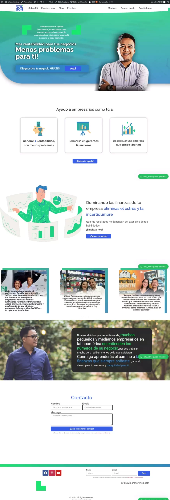

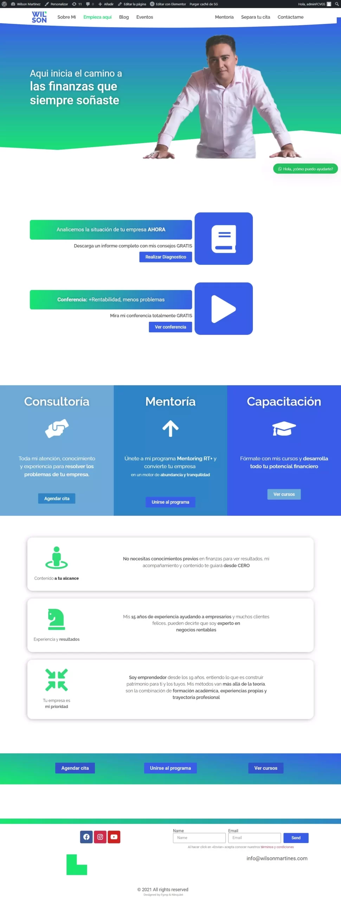

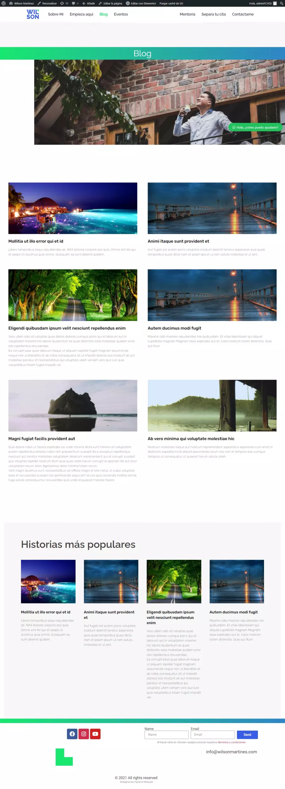

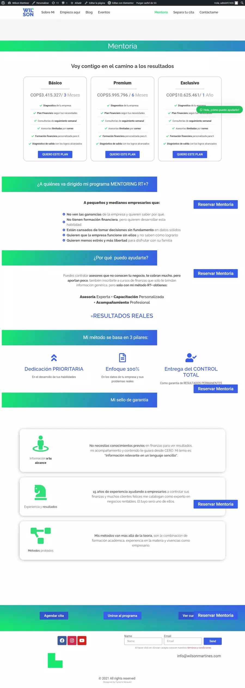

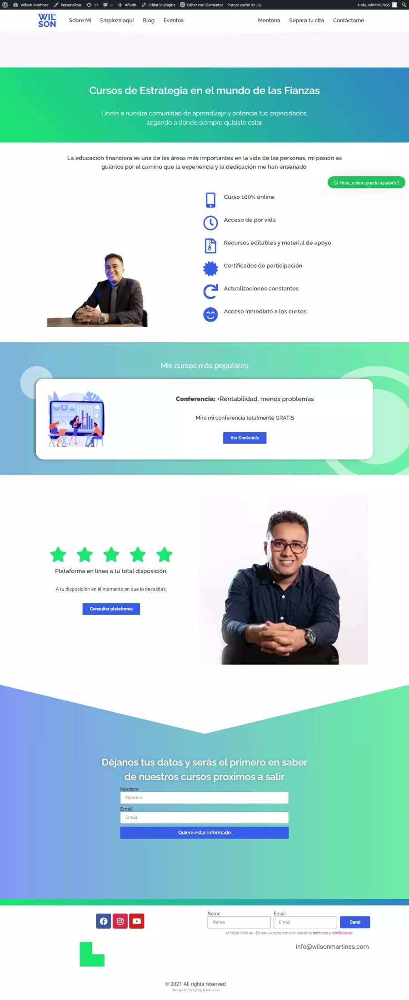

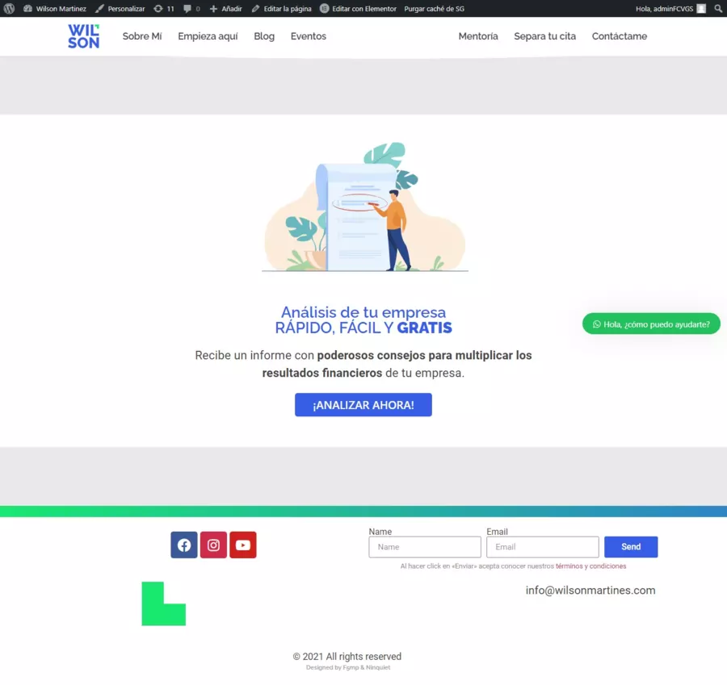
